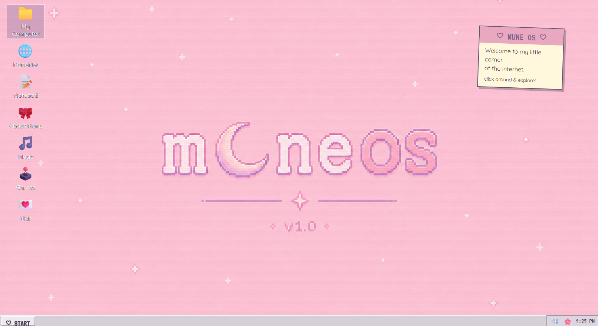
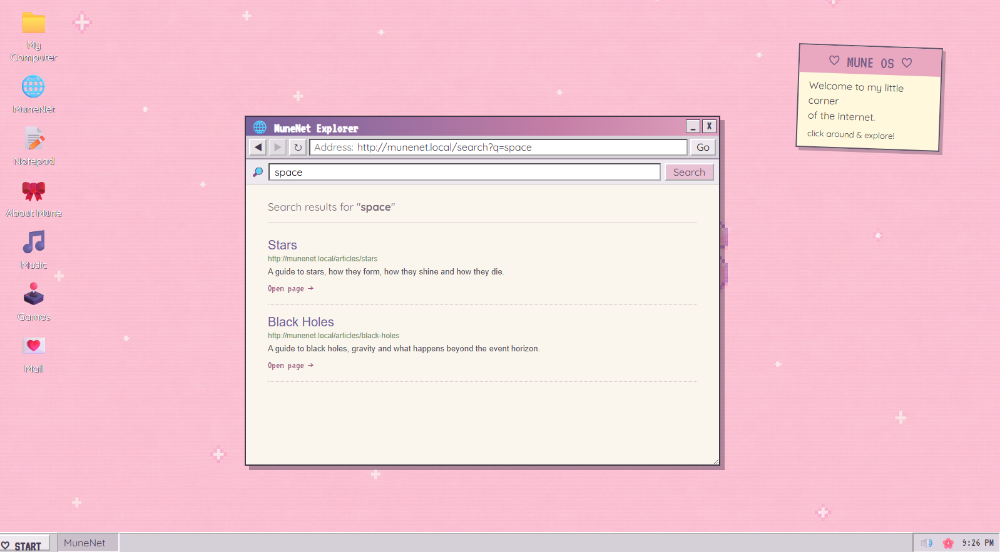
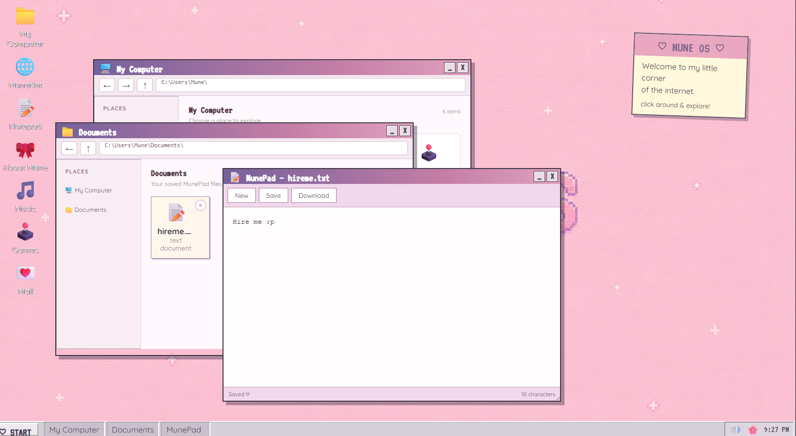

# muneOS

**A personal web project exploring an operating-system-inspired digital experience.**

## About the Project

muneOS is a personal web development project built to explore how web technologies can be used to create an interactive and organised digital experience. Inspired by the layout and feel of an operating system, the project brings together web content, navigation and custom styling in one interface.

I developed muneOS as an opportunity to experiment with front-end development, bring a creative idea to life and strengthen my practical understanding of how websites are structured and made interactive.

## Technologies Used

- **HTML** — structuring the content and interface
- **CSS** — styling the layout and visual design
- **JavaScript** — implementing interactive functionality

## Key Features

- A custom interface inspired by desktop operating systems
- Organised content and navigation
- A MuneNet browser experience for accessing project content
- Custom styling and visual elements
- JavaScript functionality to support interactive features

## What I Learned

Developing muneOS gave me practical experience in bringing together HTML, CSS and JavaScript within a single project. It helped me explore how interface design, content organisation and interactive behaviour work together, while giving me an opportunity to experiment, troubleshoot issues and improve my implementation.

The project also reflects my interest in exploring technology independently and learning by building practical applications.

## Future Improvements

Potential future improvements include expanding the available functionality, refining the user experience and exploring how AI-powered search or an intelligent assistant could be integrated into the project.

## Technologies and Project Access

**Languages:** HTML, CSS, JavaScript

## Screenshots

### Main Interface

### MuneNet Browser

### Notepad and Documents
